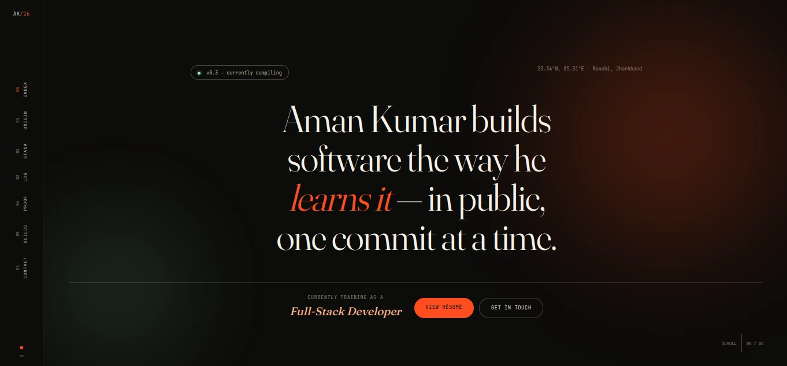

# Aman Kumar — Portfolio

> A personal portfolio and public build log for Aman Kumar — an aspiring
> full-stack developer from Ranchi, Jharkhand, India.

## What this is

This is more than a résumé page. It is an evolving record of the things Aman
is learning, building, and proving through projects, certificates, workshops,
and hackathons.

The site is intentionally honest about progress: skills are self-rated,
projects stay small enough to explain, and every section points back to real
work or an active learning goal.

## Who I am

I am Aman Kumar, a third-year B.Tech Computer Science student at ICFAI
University, Jharkhand. I am training as a full-stack developer and learning
how to turn curiosity about software into useful, understandable products.

I currently work across:

- **Frontend:** HTML, CSS, JavaScript, React, Tailwind CSS
- **Backend and data:** Python, Node.js, SQL, MySQL
- **Tools and workflow:** Git, GitHub, VS Code, Vercel, Linux
- **Current focus:** MERN fundamentals, Python, SQL, responsive interfaces, and
  shipping projects in public

## What is inside

- **Origin** — background, education, interests, and current direction.
- **Stack** — honest skill levels and the tools used to build.
- **Log** — education, achievements, and HackFest 2025 experience.
- **Proof of work** — certificates, workshops, and learning milestones.
- **Builds** — small projects and experiments.
- **Contact** — ways to connect for a project, hackathon, or question.

## Built with

The interface uses the Next.js App Router, semantic HTML, responsive AVIF
assets, lazy-loaded certificate media, generated metadata, JSON-LD, Open Graph
previews, and security headers.

## Connect

- Website: [amankumar2006.vercel.app](https://amankumar2006.vercel.app/)
- GitHub: [Aman-kumar2006](https://github.com/Aman-kumar2006)
- LinkedIn: [Aman Kumar](https://www.linkedin.com/in/aman-kumar-8b988b28b)
- Email: [amankumar.kumar2006@gmail.com](mailto:amankumar.kumar2006@gmail.com)

> Built from Ranchi, Jharkhand — one commit at a time.
